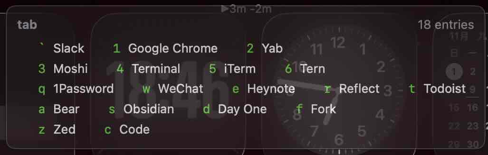
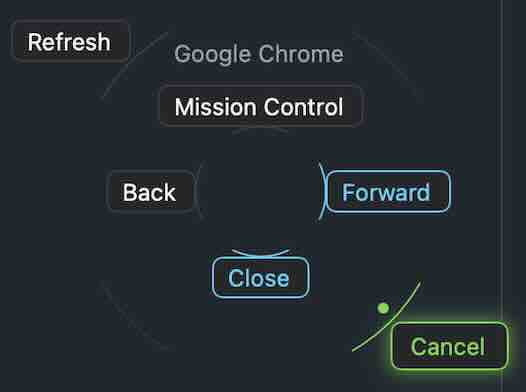

# Burin

<picture>
  <source media="(prefers-color-scheme: dark)" srcset="docs/images/icon-dark.png">
  
</picture>

macOS menubar automation host written in Go, built on [MyGo](https://github.com/egoist/mygo).
A compiled, single-binary take on the Hammerspoon idea: features are Go packages under
`internal/`, built into one small app. No bundled interpreter, no runtime dependency.

## Why you build it yourself

Burin is a personal tool, shaped by its author's habits. There are no binaries:
Accessibility permission is tied to the code signature, and the self-signed identity that
keeps it lives in your own keychain. More importantly, you are meant to fork it and change
it freely. Feature changes are best kept in your own fork; no pull request needed, tastes
differ. Bug fixes and doc corrections are welcome.

No translations are provided; ask an agent to translate the docs if you need them in
another language.

## Install

1. Install Go 1.27+: `brew install go`. Everything else, including the MyGo build tool,
   is fetched by Go on first use.
2. Fork the repository, then clone your fork.
3. Run `scripts/signing-cert.sh`. It creates a self-signed code-signing certificate,
   "Burin Signing", in your login keychain, so the Accessibility permission survives
   rebuilds. It may ask for your login password.
4. Run `scripts/restart.sh`. It builds a signed bundle into
   `build/darwin-arm64/Burin.app` and launches it. There is no need to copy it to
   /Applications. Once you have granted permissions or enabled Open at Login, do not
   move or delete the build directory.
5. Grant Accessibility from the tray item "Grant Accessibility".

The first launch writes the example config to `~/.config/burin` when it is empty. Each
status line of the tray menu opens the folder it counts, creating a missing rules file.

To update, run `git pull && scripts/restart.sh`. To sync a fork with this repository,
add it as a remote once (`git remote add upstream https://github.com/liukun/burin.git`),
then pull from `upstream`. Permissions survive rebuilds thanks to the certificate. If a permission
gets stuck anyway, reset it with `tccutil reset Accessibility io.github.liukun.burin` and
grant it again.

## Features

[`examples/`](examples) is the quickest way to see the formats: it is the config the first
launch writes.

### Leader keys

Hold a trigger key to show a HUD listing its entries, and press an entry's key to run it:
open an app, press a key combination, run a command. See [docs/leaders.md](docs/leaders.md).

### Mouse gestures

Hold the right, middle or a side mouse button, drag in one of eight directions and release
to run an action, with the gestures shown around the pointer while you hold. See
[docs/mouse.md](docs/mouse.md).

### Snippets

Type a keyword and it is replaced by its snippet, with `{placeholder|pipe}` expressions for
dynamic content and your own scripts as pipes. See [docs/snippets.md](docs/snippets.md).

### Quitter

Hide or quit an app, or close its windows, once it has not been the frontmost app for a
while. See [docs/quitter.md](docs/quitter.md).

### Timer and badges

A small bar at the top of every display shows how long you have been working without a
break, reminds you to rest, and shows the Dock badges of the chat apps you choose. See
[docs/timer.md](docs/timer.md) and [docs/badges.md](docs/badges.md).

### Clipboard flash

A 📑 grows and fades in the middle of the display under the pointer each time something
is copied, so you see the copy landed. See [docs/clipboard.md](docs/clipboard.md).

### Window rules

Pin an app's windows to a corner of a display, and keep other windows clear of a left
margin. See [docs/window_rules.md](docs/window_rules.md).

## Development

Install and develop with the steps above: `scripts/restart.sh` rebuilds and relaunches
the app, and `go test ./...` runs the tests. The event tap needs Accessibility (which
also covers Input Monitoring). The app only checks at startup; a "Grant Accessibility"
tray item triggers the system prompt when it is missing, and relaunches the app when
clicked again after granting.

## Open at login

The tray menu's "Open at Login" registers the app as a login item
(System Settings > General > Login Items). It works from the build
directory, `build/darwin-arm64/Burin.app`; the bundle must stay where it
is, as the login item points at it. Under `mygo dev` the item is
disabled, so the temporary dev bundle is never registered.

## Known limitations

- A snippet whose placeholder moves focus (e.g. `{shell(open -a X)}` followed by more text) pastes into the newly focused app.
- If writing the pasteboard fails, the keyword is already deleted and cannot be restored; the failure is only logged.
- If the snippets root directory is deleted and recreated, the watcher stops; use the tray's Reload.
- `unwrap` matches `\s` and `\d` as ASCII only.
- The snippet watcher is the hand-written fsnotify one kept from earlier, not `mygo.WatchFiles`.
- Leader entry keys are keycodes of the ANSI layout; on other layouts they follow the key's position, not its label.
- A mouse gesture holds back the drag events of its button too; with two gesture buttons down at once, only the one pressed last is tracked.
- Holding a modifier trigger swallows its combinations too: with `cmd_r.md` present, right Cmd+Tab does nothing.

## License

[MIT](LICENSE)
